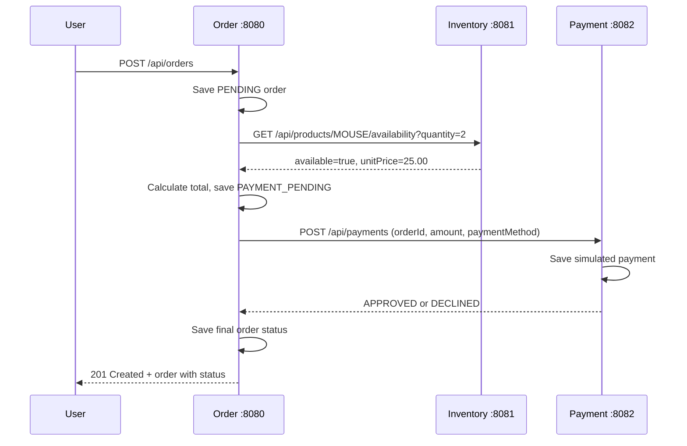

# Order Management: three small microservices

A hands-onJava, Spring Boot 3.5, Maven project. Three independent Spring MVC applications expose REST APIs and own separate in-memory H2 databases. Order Service uses Spring WebClient to call the other two services over HTTP. No shared database, service registry, gateway, Docker, or message broker is needed.



## Run locally

Install **JDK 17** and **Maven 3.6.3+**, set `JAVA_HOME` to JDK 17, and confirm `java -version` and `mvn -version` both use it.

From the project root:

```shell
mvn clean verify
```

Open three terminals in the project root and run one command in each:

```shell
mvn -pl inventory-service spring-boot:run
```

```shell
mvn -pl payment-service spring-boot:run
```

```shell
mvn -pl order-service spring-boot:run
```

Wait for each application's `Started ...Application` message. Alternatively, after packaging, run `java -jar inventory-service/target/inventory-service-1.0.0-SNAPSHOT.jar` (and the equivalent payment/order jars).

**IntelliJ:** open the root `pom.xml` as a Maven project (or use Add as Maven Project), set Project SDK and Maven runner JRE to Java 17, and reload Maven. Run `InventoryApplication`, `PaymentApplication`, and `OrderApplication`. The original compact `src/Main.java` starter has been replaced by these standard Java classes with `public static void main(String[] args)`.

## Try an order

### Postman

1. Start all three services using the commands above.
2. In Postman, click **Import** and select `postman/Order-Management.postman_collection.json` and `postman/Local.postman_environment.json`.
3. Select the **Order Management - Local** environment.
4. Run the collection in its default order: Inventory, Order, then Payment. Use one iteration with no data file.

The collection contains 25 requests with response assertions for every endpoint, including approval, decline, stock rejection, validation errors, and missing resources. The confirmed-order request captures `orderId` and `orderPaymentId`; the direct-payment request captures `paymentId`. Subsequent requests reuse those collection variables. Run **Create confirmed order - saves IDs** first when sending requests individually; run **Approve direct payment - saves ID** before fetching that direct payment.

You can edit the three base URLs in the environment. Each collection run creates new orders and simulated payments. Run against the seeded local databases; stock/price assertions assume the original seed values. Restarting a service clears its data, so rerun the collection from the beginning afterward. Direct Payment API requests demonstrate the isolated service and create additional payments for the captured order without changing its order status.

### IntelliJ HTTP client or PowerShell

Open `requests.http` in IntelliJ and click the run icons, or use PowerShell:

```powershell
Invoke-RestMethod http://localhost:8081/api/products

$body = @{ sku = 'MOUSE'; quantity = 2; paymentMethod = 'CARD' } | ConvertTo-Json
Invoke-RestMethod -Method Post -Uri http://localhost:8080/api/orders -ContentType 'application/json' -Body $body

Invoke-RestMethod http://localhost:8080/api/orders
Invoke-RestMethod http://localhost:8082/api/payments
```

The first order should contain `status: CONFIRMED`, `total: 50.00`, and a `paymentId`. IDs increase, so use the returned order ID with `GET /api/orders/{id}`.

| Input / experiment | Expected result |
| --- | --- |
| `MOUSE`, quantity 2, `CARD` | `CONFIRMED`, total 50.00 |
| `MOUSE`, quantity 1, `DECLINE` | `PAYMENT_DECLINED`; declined payment saved |
| `KEYBOARD`, quantity 1, `CARD` | `REJECTED`; no payment |
| `UNKNOWN`, quantity 1, `CARD` | `REJECTED`; no payment |
| Quantity 0, blank SKU, or unsupported payment method | HTTP 400 |
| Stop Inventory, then place an order | `INVENTORY_UNAVAILABLE` |
| Stop Payment, then order `MOUSE` | `PAYMENT_UNKNOWN` |

POST creates an order resource and returns HTTP 201 even when the business result is rejected or declined; inspect its `status`. Invalid requests return HTTP 400, and fetching an absent resource returns HTTP 404.

## Explore the code

1. `OrderController`: validates the incoming JSON and exposes create/list/get endpoints.
2. `OrderService.place`: saves the order, calls Inventory with WebClient GET, calculates the amount from the server-side price, and calls Payment with WebClient POST.
3. `InventoryController`: loads seeded products from H2 and checks quantity.
4. `PaymentController`: simulates approval (`CARD`) or decline (`DECLINE`) and saves the outcome.
5. Each `*Repository`: Spring Data JPA persistence in that service's own database.

WebClient uses `.retrieve().bodyToMono(...).block(Duration.ofSeconds(5))`. Blocking keeps this first example sequential and easy to debug in a Spring MVC request thread. This is not a fully reactive application. Every outgoing call has a five-second overall wait limit. URLs can be overridden with the `INVENTORY_URL` and `PAYMENT_URL` environment variables.

## Inspect H2

Visit `/h2-console` on any service, for example `http://localhost:8080/h2-console`.

| Service | JDBC URL | Table |
| --- | --- | --- |
| Order | `jdbc:h2:mem:order` | `CUSTOMER_ORDERS` |
| Inventory | `jdbc:h2:mem:inventory` | `PRODUCT` |
| Payment | `jdbc:h2:mem:payment` | `PAYMENTS` |

Use username `sa` and an empty password. Run `SELECT * FROM CUSTOMER_ORDERS;` in the Order console. Data resets whenever its service restarts. Inventory starts with LAPTOP (10), MOUSE (50), and KEYBOARD (0).

## Deliberate simplifications and next exercises

Inventory **only checks stock**; it does not reserve or deduct it. Repeated orders can therefore exceed stock. Payments are simulated and no money is moved. Amounts use BigDecimal; assume one currency throughout. Public entity fields keep the persistence examples small; DTOs and encapsulated entities are useful follow-up refactors.

Each database transaction is local. A payment timeout may occur after Payment saved an approval, so the order records `PAYMENT_UNKNOWN` rather than asserting failure. Inspect payments by orderId before retrying. There are no automatic retries, idempotency keys, authentication, or distributed transactions. Repeating POST creates another order/payment. A process crash can leave an order PENDING or PAYMENT_PENDING. These are intentional boundaries of this local learning project.

Try these exercises after following the happy path:

1. Set breakpoints before each WebClient call and inspect the request/response records.
2. Stop one service and compare order statuses and H2 records.
3. Add an endpoint to look up payment by orderId and reconcile unknown outcomes.
4. Add idempotency keys before adding payment retries.
5. Add stock reservation and release it on declined payment (a small saga).

`mvn test` runs an Order integration test with real HTTP downstream stubs and H2, plus service endpoint tests. `requests.http` exercises all three real applications together.
